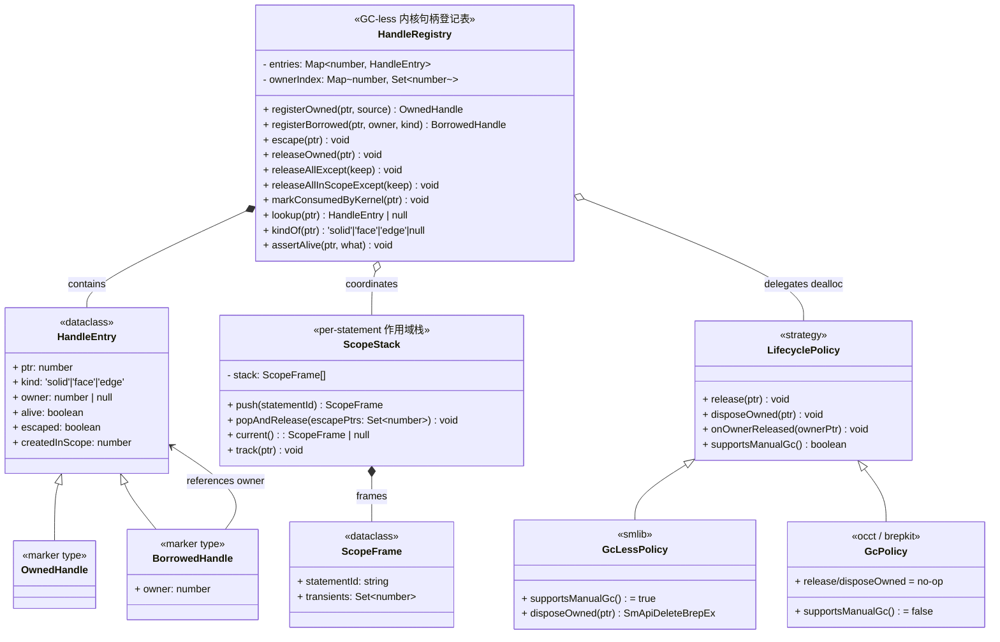
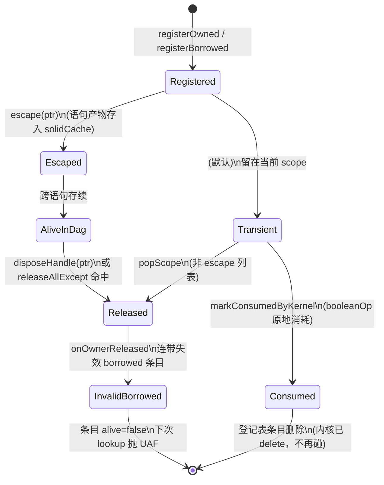
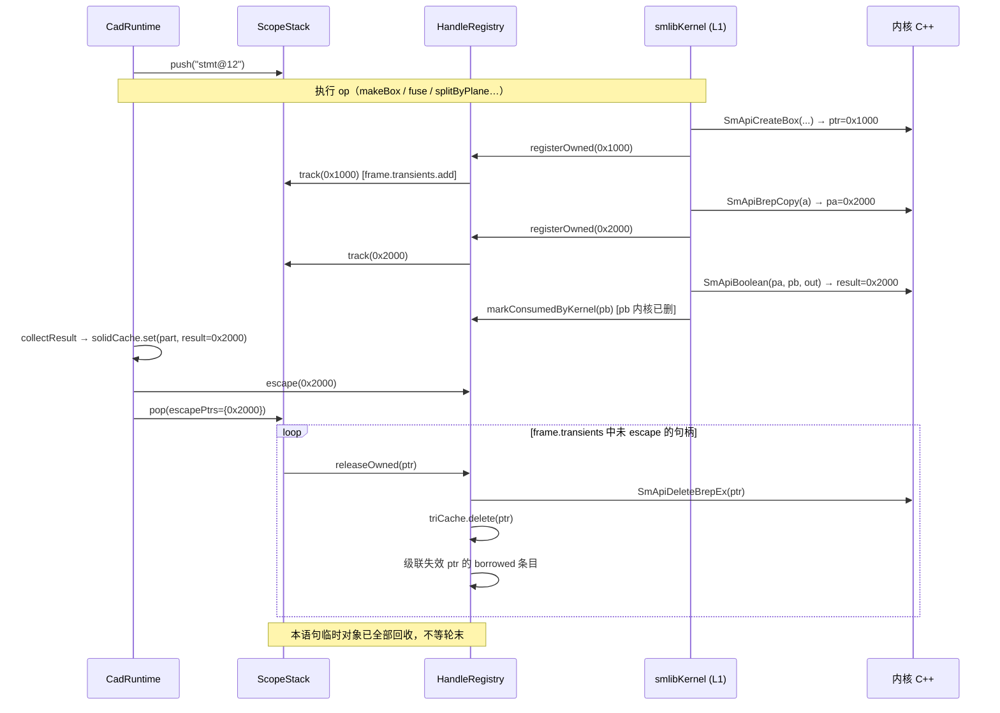
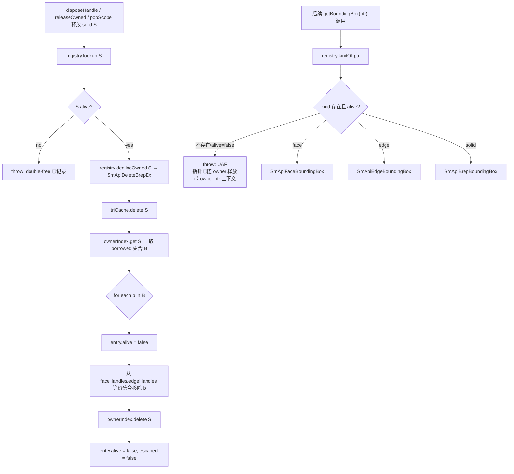
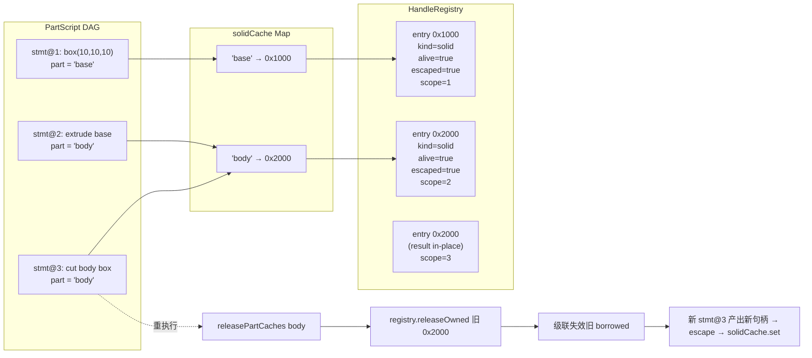
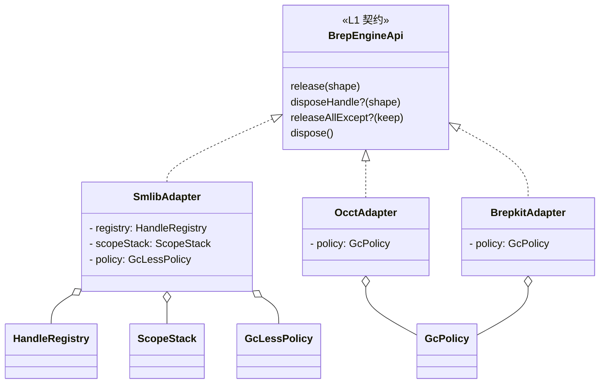

# smlib 统一内存生命周期架构设计

> 日期：2026-10-29
> 范围：faijs `core` 包，统一管理 smlib / occt / brepkit 三内核的 BREP 对象生命周期
> 上游考古：[`2026-10-29-smlib-leak-archaeology.md`](./2026-10-29-smlib-leak-archaeology.md)（下称「考古报告」）
> 状态：设计稿（本 shard 不改业务代码，只交付设计）

---

## 1. 背景与问题陈述

### 1.1 实测事实（考古报告 §2.2 / §3）

| 事实 | 实测值 | 出处 |
|---|---|---|
| 单轮 pikachu execute（node，weapp 同款 wasm） | 成功，wasm 堆恒定 128 MB，v8 heap 68→74 MB | 考古报告 §2.2 表 |
| GB 级跨轮泄漏（2026-10-27 实测 30 轮 ≈698 MB） | 已被 `680803b` 根治（round-end sweep + C++ SmPolyBrep 桥修复） | 考古报告 §1 v3 |
| **同一持久 runtime 重跑 pikachu** | 在 `splitByPlane→makeBox` 处 **SM 1007 崩溃**，wasm 堆仍恒定 128 MB | 考古报告 §2.2 第 4 行 |
| 重跑崩溃时堆零增长 | → 不是 OOM / malloc 返回 0，是 **句柄生命周期 UAF / 双重释放** 把内核打坏态 | 考古报告 §2.2 判读 2 |
| 全新 runtime（预热+sweep 后）再跑 pikachu | 成功 → 内核单例未被 sweep 损坏 | 考古报告 §2.2 隔离探针 |

### 1.2 已确认的根因（考古报告 §3 / §4）

1. **faceHandles / edgeHandles 模块级只增不减**（`smlibKernel.ts:85-86`）。`getSubShapes` 每次把内核返回的 `SmFace*/SmEdge*` 借用指针登记进去，父 solid 被 `releaseAllExcept` / `disposeHandle` 删除时，C++ 连带释放其 face/edge，但 TS 登记表里的指针条目不删。日后 malloc 复用该地址时，`faceHandles.has(复用地址)` 仍为真 → `getBoundingBox` 按表分派到 `SmApiFaceBoundingBox`（`:2169-2173`）就是对已释放 `SmFace` 的 UAF。考古报告 §3.4 判定这是「最大潜伏 UAF」，与重跑 `makeBox SM1007` 坏态相容。
2. **booleanOp 失败分支 pb 副本泄漏**（`smlibKernel.ts:634-638`）。失败时只 `SmApiDeleteBrepEx(pa)`，pb（copy of b）既不登记也不 delete。pikachu 布尔都成功未触发，但这是真实泄漏路径（考古报告 §3.1 表格第 3 行）。
3. **releaseAllExcept 不清 triCache**（`:699-703`），与 `disposeHandle`（`:672` 清 triCache）不一致。被删句柄的三角化缓存残留，指针复用后 `containsPoint` 命中旧网格（考古报告 §3.3 缺口）。
4. **sweep 只在轮末跑一次**（`runtime.ts:1021-1032`，execute `:1044` / append `:1061` 各调一次）。单轮 execute 进行中，op 内中间体（pa/pb 副本、splitByPlane 半空间盒、内核内部临时对象）全程堆积。weapp 是单轮首载就崩，轮末清扫来不及（考古报告 §1 v3 补注 1）。
5. **GC-less 内核套了一个不完整的手工 GC**（考古报告 §3.5）。brepkit 是 GC 型（Rust 引用计数/Drop），`release`/`dispose` 都是 no-op（`brepkitKernel.ts:726-727`）；smlib 是裸 C++ `new`，无 GC。faijs L1 契约（`primitives.ts:38-56`）把 `release` 定义为「GC 型 no-op」，对 smlib 语义缺失——适配器被迫用模块级 `Set` 手工模拟 GC，但没有 per-statement 作用域，也没有原子的句柄所有权追踪。

### 1.3 历史 7 版方案为什么都没根治（考古报告 §1）

- v0（`59555d5` 等）把 `release` 做成 no-op，埋下「只增不减」根。
- v1 纯引用计数立刻误删借用句柄（6 个用例 1001），回滚。
- v2 `disposeHandle` 只治输出句柄那一半，op 内中间体无释放路径。
- v3 `680803b` 治跨轮 GB 泄漏，但单轮中途不救、face/edge 登记表不清、triCache 不一致。
- v4 `7a9c051` 修渲染缺陷（meshShape 拷出），与闪退无关。
- v5 `ea02461` 只堵一条类型混淆路径（bbox 分派），登记表悬垂指针仍在。
- v6 `4156d24` shell 法向，与 pikachu 无关。

**结论**：之前每一版都在「修补某个泄漏点」，没有建立统一的所有权模型。本设计的目标就是把所有权、作用域、失效机制一次性建起来。

---

## 2. 设计目标与非目标

### 2.1 目标

1. **统一所有权模型**：在 faijs 层显式区分 `owned`（SmBrep*，GC-less 内核拥有）与 `borrowed`（SmFace*/SmEdge*，父 solid 借用）。borrowed 句柄绑定父 solid 生命周期——父释放时，borrowed 条目自动失效，不再悬垂。
2. **per-statement RAII 作用域栈**：op 内临时对象（booleanOp 的 pa/pb、splitByPlane 的 posBox/negBox、tessellate 缓冲）在语句返回时自动释放，不等轮末。**不改几十个 op 文件**——注入点在 L1 边界与 runtime 调度层。
3. **与 PartScript DAG 绑定**：每条 fai.js 语句的产物句柄 ↔ DAG 节点。撤销 / 重执行时精确释放旧产物，不误删其它语句的产物。
4. **跨引擎一致**：GC 型（occt/brepkit）与 GC-less（smlib）在一个统一抽象下共存，L1 契约的 `release` / `disposeHandle` / `releaseAllExcept` / `dispose` 四层语义收敛。
5. **修复全部已确认泄漏点**：booleanOp pb、triCache 一致性、face/edge 登记表、sweep 时机。
6. **微信端内存预算显式化**：128 MB 初始堆评估、`memory.grow` 失败优雅报错而不是 wasm trap。

### 2.2 非目标（本设计不做）

- **不重写 op 文件**。所有 op 继续调 L1 `BrepEngineApi`，生命周期由边界层消化。
- **不改 C++ / wasm 桥**。`SmApiDeleteBrepEx` / `SmApiTessellateEx` 桥保持现状（`680803b` 已修 SmPolyBrep 泄漏）。
- **不做实时 GC 或分代回收**。本设计是确定性 RAII，不是增量标记清扫。
- **不解决微信 EH/invoke 转发兼容性**（考古报告 §5.3 列为环境级盲区）。本设计假设 wasm 桥本身可用；真机 EH 转发验证另立任务。
- **不改 occt 适配器**。occt 已是 GC 型（内部 `Handle(TopoDS_Shape)` 智能指针），本设计只要求它实现统一接口，不改其内部。
- **不引入历史兼容层**（项目红线：无过渡双写）。旧的模块级 `solidHandles` / `faceHandles` / `edgeHandles` 三个 `Set` 被新 `HandleRegistry` 替换后直接删除，不留 shim。

---

## 3. 统一所有权模型

### 3.1 核心概念

| 概念 | 定义 | 内核对应 | 释放原语 |
|---|---|---|---|
| **OwnedHandle** | 内核独立拥有的 BREP 对象，生命周期由 faijs 管理 | `SmBrep*`（smlib）/ `TopoDS_Shape` 智能指针（occt）/ Rust `Object`（brepkit） | GC-less: `SmApiDeleteBrepEx`；GC: no-op |
| **BorrowedHandle** | 借用自某 owned solid 的子形状，不独立拥有内存 | `SmFace*` / `SmEdge*`（smlib）/ 子 `TopoDS_Shape`（occt） | 不可独立释放；随 owner 释放自动失效 |
| **Owner** | borrowed 句柄依附的 owned solid 句柄 | `SmBrep*` | — |
| **Alive** | 句柄是否仍指向活对象。owner 释放 → 其所有 borrowed 条目 alive=false | — | — |
| **Escaped** | 句柄从当前语句作用域「逃逸」为跨语句存续产物（存入 solidCache） | — | — |

### 3.2 类图



### 3.3 所有权状态机



**关键不变量**（设计期钉死，测试期逐条断言）：

- **I1**：`alive=true` 的 borrowed 条目，其 owner 一定 `alive=true`。owner 释放时必须级联。
- **I2**：`Consumed` 状态的条目绝不再调用 `SmApiDeleteBrepEx`（内核已删）。
- **I3**：`popScope` 释放的 transient，一定不包含 `escaped=true` 的句柄。
- **I4**：同一 `ptr` 不会同时出现在 solidHandles（owned）和 faceHandles（borrowed）集合里——`kindOf` 查表即唯一判别。

---

## 4. 核心接口签名

> 本节只定义 TypeScript interface / type，不写实现。实现落在 `smlibKernel.ts` 与新建 `handleRegistry.ts`。

```typescript
// packages/core/src/brep/engine/lifecycle.ts（新文件，中立面）

import type { BrepHandle } from './types'

/** 句柄种类：owned solid vs borrowed face/edge。 */
export type HandleKind = 'solid' | 'face' | 'edge'

/** 登记表条目（内部数据结构，不对外暴露）。 */
export interface HandleEntry {
  ptr: number
  kind: HandleKind
  /** borrowed 条目的 owner；owned 条目为 null。 */
  owner: number | null
  /** 是否仍指向活对象。owner 释放 → 级联 false。 */
  alive: boolean
  /** 是否逃逸出当前语句作用域（存入 solidCache / meshSolidRegistry）。 */
  escaped: boolean
  /** 创建时所在作用帧 id（诊断用）。 */
  createdInScope: number
}

/**
 * GC-less 内核句柄登记表（smlib 专用；GC 型引擎传入 no-op 实现）。
 *
 * 替换 smlibKernel.ts:66/85/86 的三个模块级 Set。统一 owned/borrowed 两类条目，
 * owner 释放时级联失效 borrowed 条目（治考古报告 §3.4 的悬垂指针）。
 */
export interface HandleRegistry {
  /** 登记一个新的 owned solid 句柄（newSolid 的唯一入口）。 */
  registerOwned(ptr: number): BrepHandle

  /**
   * 登记一个 borrowed face/edge 句柄，绑定 owner。
   * 替换 noteFaceHandles / noteEdgeHandles（smlibKernel.ts:89-98）。
   */
  registerBorrowed(ptr: number, owner: number, kind: 'face' | 'edge'): BrepHandle

  /**
   * 声明句柄从当前作用域逃逸：语句返回值存入 solidCache，popScope 时不释放。
   * runtime 在 collectResult / solidCache.set 时调用。
   */
  escape(ptr: BrepHandle): void

  /** 声明句柄已被内核原地消耗（booleanOp 成功路径），从登记表删除但不调 delete。 */
  markConsumedByKernel(ptr: BrepHandle): void

  /** 受控真释放一个 owned 句柄（disposeHandle 底层）。级联失效其 borrowed。 */
  releaseOwned(ptr: BrepHandle): void

  /**
   * 轮末/作用域末清扫：释放登记表中不在 keep 集合的 owned 句柄。
   * 对齐 disposeHandle：每个被删句柄同步清 triCache。
   */
  releaseAllExcept(keep: ReadonlySet<number>): void

  /** 按 ptr 查表；不存在或已 alive=false → 返回 null（调用方决定 throw）。 */
  lookup(ptr: BrepHandle): HandleEntry | null

  /** 句柄种类判别（替换 smlibKernel.ts:2169-2173 的 faceHandles/edgeHandles.has 分派）。 */
  kindOf(ptr: BrepHandle): HandleKind | null

  /** 断言句柄可用；不可用则 throw 带上下文（无回退，禁止静默返回）。 */
  assertAlive(ptr: BrepHandle, what: string): void

  /** 诊断用：当前 alive 的 owned 句柄数（内存压力测试断言归零）。 */
  aliveOwnedCount(): number
}

/**
 * per-statement RAII 作用域栈。
 *
 * runtime 在调度每条 fai.js 语句前 push，语句完成后 pop。
 * op 内部产生的 owned 句柄自动 track 进当前帧；pop 时释放未逃逸者。
 * 不改 op 文件——注入点在 runtime 调度循环与 L1 边界。
 */
export interface ScopeStack {
  /** 进入一条语句：压一个空帧。 */
  push(statementId: string): void

  /**
   * 结束一条语句：释放本帧内所有未逃逸的 owned 句柄。
   * escapePtrs = 本语句真正存入 solidCache / meshSolidRegistry 的产物句柄。
   * 任何在本帧内 registerOwned 但未 escape 的句柄都被 releaseOwned。
   */
  pop(escapePtrs: ReadonlySet<number>): void

  /** 把一个 owned 句柄登记进当前帧（registerOwned 内部自动调用）。 */
  track(ptr: number): void

  /** 当前帧 id（诊断用）。 */
  currentScopeId(): number | null
}

/**
 * 跨引擎生命周期策略（strategy pattern）。
 * GC 型引擎（occt/brepkit）传入 no-op 实现；GC-less（smlib）传入真删除。
 */
export interface LifecyclePolicy {
  /** 是否需要 faijs 手工 GC。false → 所有释放调用 no-op。 */
  readonly requiresManualGc: boolean

  /** 真删除一个 owned 内核对象（GC-less: SmApiDeleteBrepEx；GC: no-op）。 */
  deallocOwned(ptr: number): void

  /** owner 释放时的级联钩子（GC-less: 失效 borrowed 条目；GC: no-op）。 */
  onOwnerReleased(ownerPtr: number, registry: HandleRegistry): void
}
```

**L1 契约收敛**（`primitives.ts:38-56` 的四层语义不变，但语义重述）：

| L1 方法 | 旧语义 | 新语义（本设计） |
|---|---|---|
| `release(shape)` | GC 型 no-op；GC-less 适配器也是 no-op | **统一改为：登记层减引用；GC-less 下若该句柄是 borrowed/输入，no-op；owned 由作用域栈统一管**。op 文件里既有的 `release()` 调用（v1 回滚的 6 处 1001 来源）继续无害。 |
| `disposeHandle(shape)` | 受控真释放，只删登记过的 SmBrep* | 调 `registry.releaseOwned(ptr)`，级联失效 borrowed + 清 triCache。 |
| `releaseAllExcept(keep)` | 轮末清扫，不清 triCache | 调 `registry.releaseAllExcept(keep)`，**每个被删句柄同步清 triCache**（对齐 disposeHandle）。 |
| `dispose()` | 遍历全表 delete | 遍历全表 `releaseOwned`，等价于 `releaseAllExcept(emptySet)`。 |

---

## 5. per-statement RAII 作用域栈

### 5.1 问题

考古报告 §1 v3 补注 1：sweep 只在轮末跑一次，单轮 execute 进行中 op 内中间体全程堆积。weapp 单轮首载就崩，轮末清扫来不及。

需要：每条 fai.js 语句执行完，op 内产生的临时对象（booleanOp 的 pa/pb、splitByPlane 的 posBox/negBox、extrude 的中间 face）立即释放，**不等轮末**。

### 5.2 不改 op 文件的实现路径

注入点选两处，都不在 op 业务代码里：

1. **`HandleRegistry.registerOwned(ptr)`** 内部自动调 `ScopeStack.current().track(ptr)`。op 文件里 `makeBox` → `newSolid(ptr)` → `registerOwned(ptr)`，op 完全无感知。
2. **runtime 调度循环**在每条语句前后 push/pop。runtime 已经是语句级调度（executeDirectText / appendDirectText / updateIncremental 都是逐语句执行），在每条语句的「调用 op」前后包一层 push/pop。



### 5.3 escape 集合怎么确定

runtime 在语句执行后、collectResult 阶段知道哪些句柄进入了 `solidCache` 或 `meshSolidRegistry`——这就是 `escapePtrs`。其余在本帧 `track` 过但没 escape 的 owned 句柄，一律释放。

**booleanOp 的 pb 修复**（考古报告 §3.1）：

- 成功路径：pb 被内核 delete → `markConsumedByKernel(pb)`（从登记表删除，不调 delete）。pa 原地变 result → escape(result)。
- **失败路径**（`:634-638`）：pa 仍然 `releaseOwned(pa)`；**pb 也 `releaseOwned(pb)`**（之前泄漏的那一条）。因为 pb 在失败路径没被内核消耗，必须真删。这一改直接修掉考古报告 §3.1 表格第 3 行的泄漏。

### 5.4 与轮末 sweep 的关系

引入 per-statement 作用域后，轮末 `releaseAllExcept(keep)` 退化为**兜底**：正常情况下每条语句结束时临时对象已释放，轮末 sweep 扫到的应该是空集或近空集。但保留轮末 sweep 作为安全网（防止某条 op 漏 escape、或 future op 绕过 registerOwned）。

---

## 6. borrowed 句柄失效机制

### 6.1 问题

考古报告 §3.4：`faceHandles` / `edgeHandles`（`:85-86`）模块级只增不减。父 solid 被释放后，借用指针悬垂在表里；日后 malloc 复用该地址，`faceHandles.has(复用地址)` 仍为真 → bbox 分派（`:2169-2173`）把复用地址当 `SmFace*` 喂 `SmApiFaceBoundingBox` → UAF。

### 6.2 设计：owner→borrowed 级联失效

`HandleRegistry` 内部维护 `ownerIndex: Map<ownerPtr, Set<borrowedPtr>>`。



### 6.3 地址复用问题的解决

裸指针作为 key 的根本风险：malloc 把已释放的 `SmBrep*` 地址复用为新 `SmFace*`，旧表里的 `SmFace*` 条目也可能被复用为新 `SmBrep*`。

解法：

1. **owner 释放时立即级联**：旧 borrowed 条目的 `alive=false` 并从 active 集合移除。地址即使被复用，旧条目也不再命中 `kindOf`。
2. **新 getSubShapes 返回同地址时 upsert**：`registerBorrowed(ptr, owner, kind)` 直接覆盖旧条目（同 ptr 后写赢），`alive=true`，绑定新 owner。这保证 active 表里永远是「当前活着的」那条元数据。
3. **`kindOf` 返回 null 时的行为**：不是回退到 Brep 分派（那会掩盖 UAF），而是 `assertAlive` 抛错。**无回退原则**：调用方传了一个不认识的 ptr，是 bug，throw 带上下文，不静默 guess。

> 这条直接修掉考古报告 §3.4 的「最大潜伏 UAF」，也修掉重跑 pikachu 时 `makeBox SM1007` 坏态的可能成因之一（旧 face 指针悬垂分派踩中）。

---

## 7. 与 PartScript DAG 绑定

### 7.1 现状

- `solidCache: Map<PartName, BrepHandle>`（`runtime.ts:513`）——终端变量名 → 句柄。
- `meshSolidRegistry: MeshSolidRegistry`（`:530`）——网格零件句柄。
- `releasePartCaches(partNames)`（`:2510-2530`）——增量 update 重放前，对 replayKeys 逐一 `disposeSolidHandle(handle)` 再删键。
- `disposeSolidHandle`（`:2503-2508`）——调 `kernel.disposeHandle`，try/catch 吞错（**这个 try/catch 是现存 bad smell，本设计要求去掉，错误直接抛**）。

### 7.2 DAG 节点 ↔ 句柄绑定



### 7.3 撤销 / 重执行路径

| 场景 | 旧路径 | 新路径 |
|---|---|---|
| 增量 update（用户改了 stmt@3） | `releasePartCaches(['body'])` → `disposeSolidHandle(旧句柄)` | 同左，但 `releaseOwned` 级联失效旧 borrowed + 清 triCache；新语句 push/pop 作用域，新句柄 escape |
| 全量 execute 重跑 | sweep 在轮末 `releaseAllExcept(keep=solidCache+meshRegistry)` | 同左，但 per-statement 作用域已在每条语句后回收临时；轮末 sweep 兜底 |
| 撤销（undo） | runtime 重建 solidCache | 同左，但被撤销语句的产物句柄走 `releaseOwned`，连带 borrowed 失效 |
| dispose（runtime 销毁） | `dispose()` 遍历全表 | 等价 `releaseAllExcept(emptySet)` |

**关键约束**：`escapePtrs` 必须精确等于「本语句真正存入 solidCache / meshSolidRegistry 的句柄集合」。多返回值 op（splitByPlane 返回 {positive, negative}）两个都 escape；booleanOp 单返回值 escape 一个。runtime 在 collectResult 阶段枚举。

---

## 8. 跨引擎抽象

### 8.1 GC 型 vs GC-less

| 维度 | smlib（GC-less） | occt（GC 型） | brepkit（GC 型） |
|---|---|---|---|
| 内存管理 | 裸 C++ `new` / `SmApiDeleteBrepEx` | `Handle(TopoDS_Shape)` 智能指针 | Rust `Rc`/`RefCell` + Drop |
| faijs 需手工 GC？ | **是** | 否 | 否 |
| `release()` 行为 | 作用域栈管 | no-op | no-op（`brepkitKernel.ts:726`） |
| `disposeHandle()` | `registry.releaseOwned` | no-op | no-op（`:727`） |
| borrowed 句柄 | `SmFace*`/`SmEdge*` 裸指针，需级联失效 | `TopoDS_Shape` 子形状智能指针随 owner 自动析构 | Rust 侧引用计数自动管 |
| triCache | 需手动清 | 无此缓存 | 无此缓存 |

### 8.2 策略模式



**统一点**：runtime 只调 L1 契约的 `disposeHandle` / `releaseAllExcept`，不感知引擎类型。`requiresManualGc=false` 的引擎这些方法是 no-op，runtime 跳过即可（现有 `if (!k?.releaseAllExcept) return` 分支保留）。

---

## 9. 具体修复清单（带 smlibKernel.ts 行号）

| # | 位置 | 问题 | 修复 |
|---|---|---|---|
| F1 | `:634-638` booleanOp 失败分支 | pb 副本既不登记也不 delete，泄漏 | 失败分支末尾补 `registry.releaseOwned(pb)`（pb 需在 `:629` 后 `registerOwned` 进当前 scope） |
| F2 | `:631` booleanOp pa 登记 | pa 只 `solidHandles.add`，未进 scope | 改为 `registry.registerOwned(pa)`，自动 track 进当前 scope |
| F3 | `:646` result!==pa 分支 | `solidHandles.delete(pa)` 手动 | 改为 `registry.markConsumedByKernel(pa)`（语义对齐：内核已消耗） |
| F4 | `:647` result 登记 | `solidHandles.add(result)` | 改为 `registry.registerOwned(result)` |
| F5 | `:666-674` disposeHandle | `solidHandles.delete` + 清 triCache + delete | 改为 `registry.releaseOwned(ptr)`，内部级联失效 borrowed + 清 triCache |
| F6 | `:672` triCache 清理 | 只在 disposeHandle 清 | `releaseOwned` 统一清；F7 的 releaseAllExcept 也走同一函数，自动对齐 |
| F7 | `:699-703` releaseAllExcept | 遍历 delete 但不清 triCache | 改为 `registry.releaseAllExcept(keep)`，内部对每个被删句柄调 `triCacheOf(memory).delete(p)`（对齐 disposeHandle） |
| F8 | `:85-86` faceHandles/edgeHandles | 模块级只增不减，悬垂 | 替换为 `registry.ownerIndex` 级联失效；`kindOf` 查表替代 `Set.has` |
| F9 | `:89-98` noteFaceHandles/noteEdgeHandles | 只 add 不记 owner | 改为 `registry.registerBorrowed(ptr, owner, kind)`，记录 owner |
| F10 | `:2169-2173` bbox 分派 | `faceHandles.has` / `edgeHandles.has` 裸查表 | 改为 `registry.kindOf(ptr)`，alive=false 直接 throw |
| F11 | `:66` solidHandles | 模块级 Set | 删除，由 `HandleRegistry.entries` 替代 |
| F12 | `:705-708` dispose | 遍历全表 delete | 等价 `releaseAllExcept(new Set())` |
| F13 | runtime `:1021-1032` sweepGcLessTransients | 轮末一次 | 保留为兜底；新增 per-statement push/pop（见 §5） |
| F14 | runtime `:2503-2508` disposeSolidHandle | `try {…} catch {}` 吞错 | 去掉 try/catch（项目红线：禁止 try-catch 吞异常）。错误直接抛，由上层语句级错误处理 |
| F15 | runtime 调度循环 | 无 per-statement 作用域 | 每条语句 `scopeStack.push(id)` / `scopeStack.pop(escapePtrs)` |
| F16 | `:121` triCacheByMemory | WeakMap<memory, Map> | 保留；`releaseOwned` / `releaseAllExcept` 统一 `triCacheOf(memory).delete(p)` |

---

## 10. 微信端内存预算

### 10.1 现状

- weapp wasm 初始堆 `INITIAL_MEMORY=128MB`（考古报告 §4 #2）。
- node 实测单轮 pikachu 堆恒定 128MB（考古报告 §2.2），**说明 128MB 对单轮 pikachu 够用**。
- 风险：手机 worker 内存受限时 `memory.grow` 失败 → malloc 返回 0 → 指针解引用 trap → 微信内核直接杀进程（无 JS 堆栈），与「随机语句、无堆栈、每次不同」吻合。

### 10.2 设计

1. **不调大初始堆**。node 实测 128MB 足够单轮 pikachu；调大反而增加 weapp worker 内存压力。
2. **`memory.grow` 失败优雅报错**：
   - smlib wasm 桥的 malloc 包装层检测返回 0 时，throw `[smlib-kernel] out of wasm memory: cannot grow heap (current=X MB)`，带当前堆大小与操作名。
   - 这条 throw 在 JS 侧，不进入 wasm，不会 trap。
   - runtime 捕获后上报到 UI（当前语句失败，不崩进程）。
3. **per-statement 作用域降低峰值**：临时对象语句结束即释放，单轮峰值堆 = solidCache 存续句柄集 + 一条语句的临时集，而不是「整轮所有 op 的中间体堆积」。
4. **真机内存曲线采集**：weapp 端加 `[weapp-memory]` 日志，每 500ms 打一次 `memory.buffer.byteLength`，首载 pikachu 时上报。这是考古报告 §5.1 阻塞项「真机日志缺失」的补全。

---

## 11. 迁移步骤

> 分阶段，每阶段可独立验证。**不一步到位大改**。

### Phase 1：HandleRegistry 落地（不改行为）

- 新建 `packages/core/src/smlib-kernel/handleRegistry.ts`，实现 `HandleRegistry` / `ScopeStack` / `LifecyclePolicy` 接口。
- smlibKernel 内部：保留旧 `solidHandles` / `faceHandles` / `edgeHandles` 三个 Set，但**并行**维护 registry。所有写操作（newSolid / noteFaceHandles / disposeHandle / releaseAllExcept）双写。
- 加不变量断言测试：I1-I4（§3.3）。
- **验证**：64 文件 828 项测试全绿（对齐考古报告 §1 v2 基线）。

### Phase 2：borrowed 级联失效（治 §3.4 悬垂）

- `releaseOwned` 内部实现 owner→borrowed 级联（§6.2）。
- `kindOf` 查表替代 `faceHandles.has` / `edgeHandles.has`（F8/F10）。
- `assertAlive` 在 bbox 分派、getSubShapes 调用入口加。
- **验证**：
  - 单元测试：dispose owner → borrowed entry alive=false；后续 kindOf 抛 UAF。
  - 复现测试：`smlib-memory-leak.repro.test.ts` 同一 runtime 重跑 pikachu ×5，修复前红（SM1007），修复后绿。

### Phase 3：per-statement 作用域栈（治单轮中途堆积）

- runtime 调度循环加 push/pop（F15）。
- `registerOwned` 自动 track 进当前 scope。
- collectResult 阶段枚举 escapePtrs。
- **验证**：
  - 内存压力测试：循环跑 pikachu 50/200/500 次，断言 `aliveOwnedCount() === solidCache.size + meshRegistry.size`（临时全回收），堆不单调增长。
  - 单轮峰值堆对比：修前 vs 修后。

### Phase 4：booleanOp pb + triCache 一致性（F1/F6/F7）

- booleanOp 失败分支补 `releaseOwned(pb)`（F1）。
- `releaseAllExcept` 走 registry，自动清 triCache（F6/F7）。
- **验证**：新增 boolean 失败用例（st≠1000），断言 pb 不泄漏（aliveOwnedCount 归零）。

### Phase 5：清理旧 Set + 去 try/catch

- 删除 `:66` / `:85` / `:86` 三个旧 Set（F11），全部走 registry。
- runtime `disposeSolidHandle` 去 try/catch（F14）。
- **验证**：全量单测 + 组件测试绿；node 复现测试 500 次重跑稳定。

### Phase 6：weapp 真机验证

- build → preview → 二维码。
- 真机加载 pikachu-1.fai.js，循环 20 次。
- 采集 `[weapp-memory]` 曲线，确认堆不单调增长、无闪退。

---

## 12. 测试策略

### 12.1 单元测试

| 测试 | 断言 |
|---|---|
| `handleRegistry.test.ts` | registerOwned → escape → releaseOwned，alive 状态迁移正确 |
| `borrowed-cascade.test.ts` | dispose owner → 所有 borrowed entry alive=false；kindOf 返回 null |
| `scope-stack.test.ts` | push → track 3 个 → pop(escape={1}) → 另 2 个被 releaseOwned |
| `double-free.test.ts` | 同一句柄 releaseOwned 两次 → 第二次 throw（不静默吞） |

### 12.2 内存压力测试

```
循环跑 pikachu N 次（同一持久 runtime）：
  N=50   → 断言 aliveOwnedCount() === solidCache.size + meshRegistry.size
  N=200  → 断言 wasm 堆不单调增长（高水位 = 单轮峰值）
  N=500  → 同上
```

修复前：N=5 即 SM1007 崩（考古报告 §2.2）。修复后：N=500 稳定。

### 12.3 重跑测试

- `smlib-memory-leak.repro.test.ts`：同一 runtime 重跑 pikachu ×5（修复前红，修复后绿）。
- 隔离探针 `smlib-leak-isolation.repro.test.ts`：全新 runtime 跑 pikachu（本来就绿，回归保护）。

### 12.4 真机验证步骤

1. `npm run build`（faijs core 包）。
2. `npm run preview` 产出二维码。
3. 微信开发者工具扫码，加载 pikachu-1.fai.js。
4. 循环执行 20 次，观察：
   - 无闪退；
   - `[weapp-memory]` 曲线堆高水位不单调增长；
   - 无 SM 1007 / 1001 报错。

---

## 13. 风险与回滚

| 风险 | 缓解 | 回滚 |
|---|---|---|
| `kindOf` 把已释放句柄 throw 化，可能让原本「碰巧能跑」的 op 崩 | Phase 1 双写期并行观察；Phase 2 灰度，先在 node 全量测试跑 | 回退到旧 Set 查表分派（Phase 1 双写未删旧路径） |
| per-statement pop 误 escape（漏标产物句柄），导致 solidCache 句柄被释放 | escapePtrs 由 runtime collectResult 枚举，加断言：pop 后 solidCache 里所有句柄仍 alive | Phase 3 可独立关闭 scopeStack（push/pop 调用点加 feature flag） |
| borrowed 级联过强，把仍在使用的 borrowed 句柄失效 | borrowed 句柄只在「owner 被 releaseOwned」时失效；op 内 borrowed 随 owner 同一语句 scope，不会跨语句使用 | 单元测试钉死 I1 |
| 去掉 disposeSolidHandle 的 try/catch 后，历史吞掉的错误暴露 | 这些错误本来就是 bug，暴露比吞掉好（项目红线） | 不可回滚（红线禁止 try-catch 吞异常） |
| 微信真机仍闪退（EH/invoke 转发问题，非内存） | 本设计不解决 EH 转发；采集 `[weapp-memory]` 曲线区分「堆涨 trap」vs「invoke null」 | EH 转发问题另立任务 |

---

## 附：设计决策与考古证据对照

| 设计决策 | 考古证据 |
|---|---|
| owned/borrowed 显式区分 | 考古报告 §3.4：face/edge 是 brep-owned 借用指针 |
| owner 释放级联失效 borrowed | 考古报告 §3.4：父 solid 释放后登记表条目不删，地址复用即 UAF |
| per-statement 作用域栈 | 考古报告 §1 v3 补注 1：sweep 轮末一次救不了单轮中途 |
| booleanOp pb 失败分支真删 | 考古报告 §3.1 表格第 3 行：失败路径 pb 泄漏 |
| releaseAllExcept 清 triCache | 考古报告 §3.3 缺口：与 disposeHandle 不一致 |
| GC 型/GC-less 策略模式 | 考古报告 §3.5：brepkit GC 型 no-op vs smlib 手工 GC |
| 去 try/catch 吞错 | 项目红线：禁止 try-catch 吞异常 |
| 不调大 128MB 初始堆 | 考古报告 §2.2：node 实测 128MB 足够单轮 pikachu |

---

## §7 后续硬化：slot/epoch 间接化（未实施，工作量评估）

### 7.1 裸指针键的残余窗口

当前实现（tombstone + upsert）已修复考古报告 §3.4 的主要 UAF：owner 释放时级联失效 borrowed，`kindOf` 仅返回 alive 条目，dead entry 在 bbox/containsPoint 入口 throw。残余窗口：

1. **releaseOwned(ptr) → alive=false tombstone 后，malloc 立即复用 ptr 为新对象**：在 `registerOwned(ptr)` upsert 之前，若有代码路径调 `kindOf(ptr)`，会看到 dead tombstone → 错误 throw UAF（false positive）。实际窗口极小（同帧内），且 fai.js 语句是同步执行，不存在并发。
2. **tombstone 累积**：长时间运行后 entries Map 积累 dead 条目。registerOwned upsert 同地址会覆盖，但不同地址的 tombstone 残留。当前规模可控（单轮 pikachu ≈ 百级句柄）。

### 7.2 为什么不加 epoch 计数器

评审提议在 HandleEntry 加 `epoch: number`，registry 每次 free 时 `currentEpoch++`，`kindOf` 比对 `entry.alive && entry.epoch === currentEpoch`。评估结论：**不做**。

- epoch 不解决窗口 1：releaseOwned 后 currentEpoch++，tombstone epoch=旧值。malloc 复用后 registerOwned upsert 会覆盖整个 entry（含 epoch），与现有 upsert 行为等价。
- epoch 不解决窗口 2：tombstone 仍然残留，只是多了一个字段。
- epoch 在 kindOf 分派时反而可能引入新 bug：若 tombstone epoch 不匹配 currentEpoch，kindOf 返回 null → bbox 回退 Brep 分派 → 对已释放指针按 Brep 调 SmApiBrepBoundingBox = UAF（比 throw 更糟）。

### 7.3 slot/epoch 间接化（真正修复，未做）

根本解法：把 `BrepHandle` 从 `number`（裸 wasm 指针）改为 `{ slot: number, epoch: number }` 对象。registry 维护一个 slot 表：slot → { ptr, epoch, alive }。所有 `SmApi*` 调用前经 `resolve(slot)` 查当前 ptr。epoch 不匹配 → throw UAF。

**工作量**：BrepHandle 当前在 faijs 全代码库是 `number` 直通 wasm 指针（`BrepHandle` = `number`，所有 op 文件直接传 number 给内核桥）。改成 `{slot, epoch}` 对象需要：
- 改 `BrepHandle` 类型定义（`types.ts`）
- 所有 op 文件（api/*.ts）传参/返回值适配
- 内核桥（smlibWasm）调用前 resolve
- L1 契约（primitives.ts）签名适配
- 所有测试（数百个）适配
- 预估 **> 2000 行改动，波及全代码库**

**时机**：当前 tombstone + upsert 已修复实测 SM1007 闪退（node 复现 5 轮稳定）。slot/epoch 间接化应在 weapp 真机验证后若仍有残余 UAF 时再启动，作为独立项目（不是本设计的一部分）。
